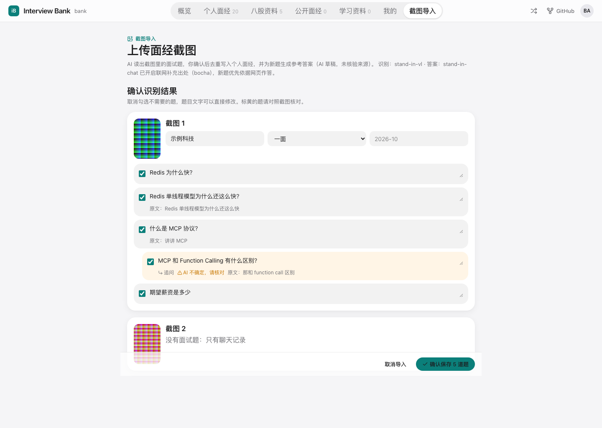

# Interview Bank Skill

English | [简体中文](README.md)

`interview-bank` is an interview-question organization Skill for Claude Code, Codex and other agents that support Agent Skills. It helps users extract questions from screenshots, selected text, web pages, recorded speech in audio/video, or subtitle transcripts collected over time, classify them by role, technical domain, technology, company and industry, merge equivalent wording, research sourced reference answers, and produce two reports for reading and self-testing. It turns scattered interview material into a growing personal reference bank.

Suitable for internships, campus recruitment, autumn recruitment and experienced-hire interviews. Current version: **1.35.0**. See the [CHANGELOG](CHANGELOG.md) and [GitHub Releases](https://github.com/EXIST-D/Interview-bank/releases).

## This update: 1.34 AI mock interview and answer feedback

- The page gains Mock interview: the AI interviewer asks only questions from your own bank, chosen by area (topic, domain, technology, company; optionally only due, weak or unseen ones) or from a pasted job description, where the AI picks relevant questions and you tick the ones you want; requirements the bank does not cover are listed, never filled with invented questions.
- You write your answer and it is saved verbatim; the AI checks it against the sourced reference answer, key point by key point (covered, partly, missed), comments on accuracy, coverage, boundaries and wording, quotes your own words, and asks a follow-up when one is worth it. No score, and it never rates you.
- Quotes in the feedback are verified word for word. With no sourced reference answer (or after the wording changed) the feedback covers structure and wording only, never correctness. *Check my answer with AI* is also below every question.
- Mastery stays your own click (again / hard / good / easy) in the review plan; interviews are the same `interview` records as on the command line, so an agent can read and continue them.
- Feedback and job-description picking share the usage ledger and daily budget; `limits.daily_feedback` caps feedbacks per day. Needs `web --ai-config` and `--allow-practice` (V2 bank).

Try the [online test site](https://exist.qd.je/) without an account for public reading. Contact the maintainer on QQ **1939123241** for full-feature testing and suggestions.

## Interface preview

Live Markdown notes beside the original, shown with synthetic demonstration material:


Overview: continue reading, the four sections and the most-asked questions.


Personal interviews: list, segmented views and topics on the left; reference answer, sources and related material on the right. Notes open from the reader toolbar.


Screenshot import: check each question the AI read, untick or reword it, and review highlighted ones.



Notes: a source's contents, the list grouped by topic, and the collection's answer with learning state and how interviews asked it.


On a phone: the list with the bottom tab bar (left), the full-screen reader with previous/next (right).

<p>


</p>

All come from the `demo` sample bank (synthetic questions, fictional companies, notes written for the demo); anyone can reproduce them with `demo --bank <new dir>` and `web`.

## Repository layout

```text
Interview-bank/
├── README.md / README.en.md
├── CHANGELOG.md                  # version history
├── CONTRIBUTING.md / SECURITY.md
├── LICENSE
├── .github/workflows/ci.yml      # tests on Windows/macOS/Linux × Python 3.10–3.13, lint, Web bundle rebuild, legacy-format run, package check
├── web/                          # Web reader source (React + Vite + Tailwind), built into skills/interview-bank/assets/web/
├── tests/                        # standard-library unittest suite (not installed with the Skill)
├── evals/                        # evaluation datasets, scorer, recorded runs, host verification
├── tools/                        # packaging, release checks, synthetic fixtures, measurements, eval runners, server deployment (deploy/)
├── examples/                     # sample structured answer
├── assets/readme/                # README images, not installed
└── skills/
    └── interview-bank/           # the installable Skill
        ├── SKILL.md
        ├── LICENSE.txt
        ├── agents/openai.yaml
        ├── assets/web/           # local Web reader (prebuilt; no Node needed to use it)
        ├── references/           # protocols for each step
        └── scripts/
            ├── ibank.py          # CLI entry point
            └── ibank_core/       # data engine
```

## Capabilities

| Step | What it does |
|---|---|
| Intake | Screenshots, selected text, web page bodies, audio and video speech, SRT/VTT/TXT/JSON subtitles (including Bilibili and YouTube auto-captions); identical files never add frequency |
| Extraction | The agent reads images or transcripts, keeping original wording, follow-up links, company/round/date; low confidence and contact details become review items |
| Classification | 68 roles, 186 domains, 235 technologies, 83 industries; Chinese labels, aliases, multiple labels, hierarchical filters |
| Deduplication | Candidate retrieval (boilerplate removed, common English terms mapped) plus the agent's semantic judgment; uncertain pairs can go to the user in the Web reader |
| Reference answers | Primary sources read and mapped per key point; optional verified quotes; `answer-recheck` for wording-only changes |
| Reports | Two Markdown editions plus a JSON sidecar; JSON/JSONL/CSV/Anki exports; English or Chinese |
| Maintenance | V2 personal state, field protection, never-merge rules, research workflows, undo, change-set runs, `gc`, standalone backup and restore |
| Preparation | JD topics with coverage gaps, daily plan calendars, review queues (simple or FSRS), one-question-at-a-time mock interviews |
| Public material | Interview notes by source/topic/chapter; public interviews by topic/company/year; five learning-category cards with source/text filters; provenance, verification status and personal/public interview links |
| Web reader | Personal, Notes, Public and Learning sections; peek, read marks, random pick, folding chapters, focus reading; self-rated practice, human review, merge decisions; can run on your own server for a phone |

## Agent capabilities and requirements

The Skill uses the agent's vision, reasoning and web tools; the agent path is not tied to one model API, while the Web import and web sources use the models and search service configured on the server. The agent understands material and researches answers; the Python CLI validates, stores transactionally, queries and exports.

- Python **3.10 or newer**; the core and subtitle parsing use only the standard library. Local transcription of raw audio/video optionally uses `faster-whisper==1.2.1`.
- The agent must view local images, read and write the files the user allows, and run Python; sourced answers need web search and page reading.
- Installing with `npx` needs Node.js/npm; the Python core does not.
- Keep banks and outputs outside the installed Skill directory.
- The CLI does not go online by default; only `verify-citations` (link checks, on request), `page-text` (saving cited pages while researching answers) and, with `web --ai-config`, the Web import, web sources and `ai-check` make network requests (see [SECURITY.md](SECURITY.md)).

## Installation

If you are not familiar with installation commands, tell your agent:

> Please install this Skill for me: [https://github.com/EXIST-D/Interview-bank](https://github.com/EXIST-D/Interview-bank), and give me a short introduction.

The Skill is listed on [skills.sh](https://skills.sh/exist-d/interview-bank/interview-bank). Install with the `skills` CLI (Codex shown):

```powershell
npx skills add EXIST-D/Interview-bank --skill interview-bank --agent codex --yes --copy
```

Other agents use the same command with their `--agent` value (paths from the [skills CLI](https://github.com/vercel-labs/skills); add `-g` for a user-wide install):

| Agent | `--agent` | Project path | Global path | How to invoke |
|---|---|---|---|---|
| Claude Code | `claude-code` | `.claude/skills/` | `~/.claude/skills/` | Natural language; matched by the Skill description |
| Codex | `codex` | `.agents/skills/` | `~/.codex/skills/` | `$interview-bank …` or natural language |
| Cursor | `cursor` | `.agents/skills/` | `~/.cursor/skills/` | Natural language |
| Trae / Trae CN | `trae` / `trae-cn` | `.trae/skills/` | `~/.trae/skills/` / `~/.trae-cn/skills/` | Natural language |
| Qwen Code | `qwen-code` | `.qwen/skills/` | `~/.qwen/skills/` | Natural language |
| Gemini CLI | `gemini-cli` | `.agents/skills/` | `~/.gemini/skills/` | Natural language |

What has actually been verified on each host is recorded in [host verification](evals/host-verification.md). You can also copy `skills/interview-bank` into your agent's skills directory, or download the checksummed ZIP from [Releases](https://github.com/EXIST-D/Interview-bank/releases). Reload the project or restart the client if the skill list does not refresh.

## Try it

```text
python -B <skill dir>/scripts/ibank.py demo --bank <new dir>
python -B <skill dir>/scripts/ibank.py web --bank <new dir> --open
```

`demo` builds 20 synthetic questions, 8 with reference answers checked against official documentation, and a small notes collection written for the demo (5 notes, linked to the questions).

## Examples

```text
Use interview-bank to organize these interview screenshots, classify and merge equivalent questions, add sourced reference answers, and produce both reports.

Organize the questions only; no answers. Leave out self-introductions.

Add this interview write-up page to my bank (I have it open).

Find the most frequent Redis backend questions in my bank and add answers backed by official documentation.

From this job description, pick 30 questions from my bank, explain coverage and gaps, export both reports and plan 10 a day.

Ask me 10 questions from this topic one at a time, give feedback after each answer and summarize weak areas at the end.

Export my bank as Anki cards.

Open the local Web reader; I want to review answers myself and settle the uncertain merges.
```

## The Web reader: study on a computer or a phone

The agent organises the bank; the Web page is for reading it. By default the page runs no AI and searches nothing online; it only reads your bank. With screenshot import or the mock interview enabled on the server, the screenshots you upload and the answers you write go to the model you configured.

- **Overview and four sections:** a top bar (a bottom tab bar on phones) switches the overview and the sections. *Personal* holds your collected questions. *Notes* keeps Q&A, explanations, coding solutions and cases by source. *Public* groups interviews across sources by topic or year, with company/year filters. *Learning* offers five category cards for roadmaps, tutorials, resource indexes, career material and industry news. Every entry retains its text and provenance, and interviews and notes link both ways.
- **My answer and my notes:** write your own answer or note below the reference or the original; it may stay empty, is independent of it and syncs across devices. The 我的 (Me) page lists, searches and exports them all and holds your favourite folders (practise from a folder).
- **Outline for long text:** long interview write-ups and notes get "on this page" jumps to each question.
- **Today's plan:** the overview counts reviews due, weak and never-practised questions and starts a review round.
- **Made for spare minutes:** on a phone, a list and a full-screen reader with previous/next at the bottom, a swipe, or the system back gesture to close; a peek at any answer from the list; read marks and group progress; a random pick that prefers unread questions; Think first hides answers by default.
- **Side by side on a computer:** list and reader together, plus a contents column for a notes source. The list folds away, and Focus also hides the top bar so the reader fills the window at a comfortable line length.
- **Easy on the eyes:** three text sizes, a reading progress bar, light / dark / system themes, highlighted search words; tables, code, quotes and nested lists in long answers render properly. Read marks, folds, text size, source order and theme stay in the browser.
- **Mock interview and answer feedback** (when the server enables them): the AI asks only questions from your own bank (by area or job description), you answer, and it checks your answer against the sourced reference answer, point by point, with follow-ups; answers are saved verbatim as practice records and you rate your own mastery.
- **Screenshot import and web sources** (when the server enables them): upload → AI reads → you confirm → deduplicated into the bank → answers written from web pages with sources (an AI draft when nothing supports one); existing drafts get sources with one click, all in the page; setup in [Web usage](skills/interview-bank/references/web.md).
- **Practice and your own decisions** (on a writable reader): practise a round or one question with a self-rating (V2 banks save progress and schedule reviews), **human review** of answers and **merge decisions** on pairs the agent was unsure about; only you can do these.

| Shortcut (computer) | Action |
|---|---|
| ← / → or K / J | Previous / next |
| Space | Show the answer (in Think first) |
| / | Search |
| F | Focus (fold the top bar and the list) |
| L | Fold / unfold the list |
| Esc | Leave focus |

### Three ways to use it

| Way | For | How |
|---|---|---|
| **On your computer** | Reading on the machine where your bank is | `python -B <skill dir>/scripts/ibank.py web --bank <bank> --open`. Loopback only (127.0.0.1), no login; Ctrl+C stops it and `--read-only` disables writes. Or ask the agent to open your bank's Web reader. |
| **On your own server** | Reading on a phone anywhere | The read-only reader sits behind your own HTTPS reverse proxy: its own login page (hashed passwords, lockout after failures), one bank per account, daily verified backups; with `--allow-personal` you can write answers and notes, keep favourites and sync learning state on the phone, and `--allow-practice` also saves practice ratings (V2 banks); `--allow-intake --ai-config` imports screenshots from the phone, and a `search` section adds web sources (example `tools/deploy/ai.example.json`; check it with `ai-check`). `tools/deploy/sync.sh` copies the bank text and notes from your computer, never screenshots; `tools/deploy/pull-backups.sh` brings the server's backups back to your computer. Steps: [Web usage](skills/interview-bank/references/web.md) and `tools/deploy/`. |
| **Test it with the author** | Trying the hosted reader first, or when you cannot deploy one yet | Contact the author through [GitHub Issues](https://github.com/EXIST-D/Interview-bank/issues) for an account to test with. Each account sees only its own bank; the server keeps the bank text, plus screenshots you import in the page, inside your own bank; deleted on request. |

## Processing policy

Default flow: **extract → classify → deduplicate → commit → research reference answers → export both reports**.

- Similarity only finds candidates; the agent decides merges from the full meaning and hands uncertain ones to the user. Languages, versions, scenarios and complexity constraints are never dropped to shrink the count.
- Answers prefer official documentation, original papers and first-party sources, with every key point mapped to a citation. "Verified against sources" and "human-reviewed" are different states; only the user can create the latter.
- Before researching more than 20 questions the agent tells you the count and batches and lets you choose all, only the most frequent, or the question edition first.
- Work runs in batches of 5–10, deduplicated before research; both editions render from the same data.
- A questions-only request skips research; queries, exports or Skill changes never start a bank-wide research run.

## Generated bank and reports

```text
<bank directory>/
├── manifest.json / config.json
├── data/                         # questions, occurrences, sources, companies, answers, relations; V2 adds state.json
├── runs/                         # task packets, stages (change sets), commit receipts and audit
├── media/                        # retained source copies when chosen
├── backups/                      # verified backups from backup create and migrations
└── exports/
    ├── 面试题整理报告.md
    ├── 面试题整理报告（题目版）.md
    └── 面试题整理报告.md.details.json
```

- **Answer edition:** topic overview at the top; each question has its reference answer, source links, frequency, companies, labels and evidenced years; spoken version, follow-ups and pitfalls are folded.
- **Question edition:** the same questions and order without answers, for self-testing.
- **Structured sidecar:** internal IDs, original wording, exact dates, source links, full classification and answer history.

The JSONL files in `data/` are the only source of truth and are queried directly; every change goes through stage, validation and commit with history and audit. Frequency counts collected occurrences, not interview participants or market probabilities.

## Status and plans

**v1.32.0** implements everything in the capabilities table above. Existing V1 banks keep extraction, classification, deduplication, answer research and export; saved topics, durable research workflows and review state need a backed-up upgrade to V2. Updating the Skill never migrates a personal bank or marks old answers as re-verified.

**Not implemented yet:**

| Area | Note |
|---|---|
| On-screen text in videos | Only speech is processed; capture silent on-screen questions as screenshots |
| Speaker separation, resuming inside long recordings | Speaker labels from the tool are kept; resume is per file |
| Editing in the Web reader | Screenshots can be imported in the page (when enabled); question edits and other intake stay with the agent |
| Real-time sync and offline merging | Read marks, learning states and source order already merge through the server; folds and text size remain partly browser-local, without real-time sync |
| MCP server | Planned as a separate optional package; the core stays dependency-free |

**Other limits:** review queues are generated on demand with no background reminders; exact token and cost figures depend on the host; splitting an arbitrary historical merge is not supported, only undoing the latest eligible operation.

**Verification:** v1.32.0 passed the full 416-test suite on macOS, lint, the Skill package/install check and the Web bundle rebuild check. The Web reader also passed 89 browser checks (computer and 390px phone) served by the Python reader under its real Content-Security-Policy with no violations, covering the four sections, notes, favourites, practice, learning-state sync, and screenshot import, merge decisions and web sources (with loopback stand-in models and search); all run in CI (`pnpm e2e`). Screenshot import and web sources were also tested end to end with real DeepSeek models and real web pages. CI covers Windows, macOS and Linux × Python 3.10–3.13, the Web rebuild comparison, the legacy snapshot format and packages on all three systems; run the suite with `python -B -m unittest discover -s tests`. Historical Evaluation results and host checks are in [evals](evals/README.md): dedupe retrieval recall@10 is 1.00; blind dedupe judgments made 0 % false merges and 3.4 % missed merges (Opus and Sonnet); blind answers scored 1.7 / 2 from a separate judge with no unsupported claims; on Claude Code the trigger suite passes with Sonnet, while Haiku's recall (0.73–0.80) is below the gate. Extracted content and reference answers still need checking against the original material, sources and scope.

The repository contains the Skill, tests, evaluations and development tools, documentation, license and the README image. Personal material, banks, research ledgers and local environments are not published; test and evaluation data are synthetic.

## Author and maintenance

Created and maintained by [EXIST-D](https://github.com/EXIST-D).

Issues, feedback and suggestions are welcome in [GitHub Issues](https://github.com/EXIST-D/Interview-bank/issues); see [CONTRIBUTING](CONTRIBUTING.md), and [SECURITY](SECURITY.md) for vulnerabilities. Remove personal information, private screenshots and sensitive bank content from any example you submit.

## License

This repository uses the **MIT License**; see [LICENSE](LICENSE). The Skill also ships a copy: [skills/interview-bank/LICENSE.txt](skills/interview-bank/LICENSE.txt).

The license covers this repository's code and documentation; screenshots, question material and cited third-party sources remain subject to their own rights and terms.
